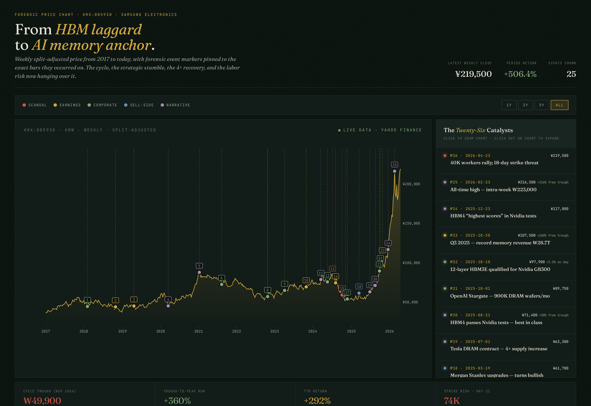
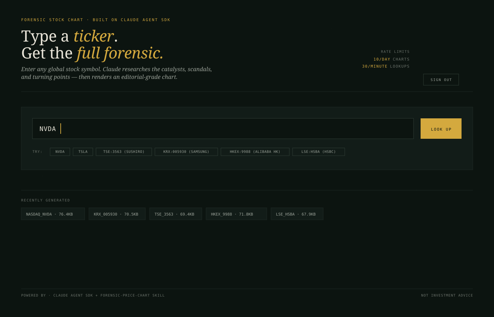
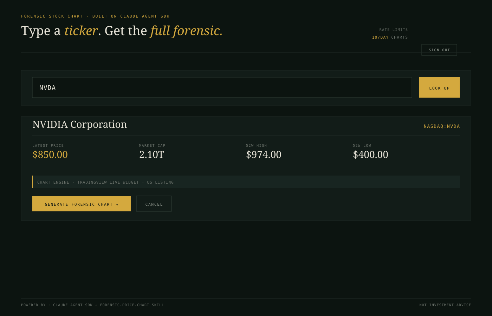
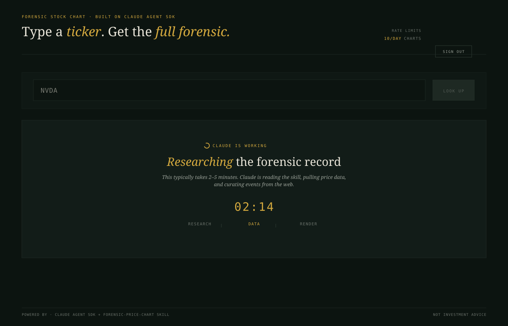

<div align="center">

# Forensic Stock Chart

**English** · [简体中文](README.zh-CN.md)

Every interesting bend in a price chart invites a question: what changed?

**Type a ticker. Get a self-contained HTML chart with annotated catalysts, scandals, and turning points.**

Built on the [Claude Agent SDK](https://docs.claude.com/en/agent-sdk) — the AI does the research, you ship the chart.

[](docs/screenshots/05-real-samsung-chart.png)

<sub>Sample output — Samsung Electronics (KRX:005930), 25 forensic events pinned to weekly close prices. Generated in ~3 minutes by Claude with the forensic-price-chart skill.</sub>

[Quick deploy →](#quick-deploy-to-render) · [Bring your own skill →](#bring-your-own-skill) · [How it works →](#how-it-works)

</div>

---

## What this is

A web app that wraps a [Claude Agent Skill](https://docs.claude.com/en/agents-and-tools/agent-skills/overview) in a clean ticker-search UI:

```
Sign in  →  Type ticker  →  Preview metadata  →  Click "Generate"  →  Chart appears
                                                  (Claude works ~2-5 min)
```

The skill is the brain. This repo provides:

- **A FastAPI backend** that resolves any global ticker (US, HK, JP, KR, EU, ...) via yfinance and runs Claude with a skill loaded
- **A 2-step UI** in editorial dark-green/amber design (search → preview → generate → chart)
- **Auth + rate limiting** because each chart costs ~$1.50–3 in API spend
- **24h caching** so repeat requests are free
- **Render Blueprint** for one-click deploy

The repo ships with a minimal **placeholder skill** so the app boots and shows something. To get real forensic charts you replace the placeholder with your own skill — see [Bring your own skill](#bring-your-own-skill).

---

## Why "skill" not "prompt"?

A prompt lives in the request and gets re-sent every time. A [skill](https://www.anthropic.com/engineering/equipping-agents-with-the-real-world-with-skills) is a folder in `.claude/skills/` that the agent loads on demand — it can have its own templates, references, and procedures. This is the difference between writing instructions in chat ("please make a chart of...") versus shipping a coherent capability ("forensic-price-chart skill").

For this kind of work — research-heavy, opinionated formatting, proprietary methodology — skills are the right unit of abstraction. Your skill is your IP.

---

## Screenshots

The four UI states (mockups), and a real generated chart:

|  |  |
|---|---|
|  |  |
| **Search.** Type any global ticker. Inline examples for non-US markets. | **Preview.** yfinance resolves the symbol and shows metadata before committing API spend. |
|  |  |
| **Working.** Honest "this takes 2–5 min" state with timer + stage cycling. | **Result.** A self-contained HTML chart loads in an iframe. Open / download / share. |

A real generated chart (Samsung Electronics, KRX:005930):


<sub>25 forensic events across 5 categories (scandal/earnings/corporate/sell-side/narrative), each pinned to the actual weekly close. Click any event in the right rail to highlight on the chart, or vice versa. Generated in ~3 minutes.</sub>

---

## Quick deploy to Render

5 minutes from zero to live URL. The repo includes a `render.yaml` Blueprint.

### 1. Push to GitHub

```bash
git clone https://github.com/Bill306/forensics.git
cd forensics
# (or fork via the GitHub UI)
```

### 2. Connect to Render

1. https://dashboard.render.com → **New +** → **Blueprint**
2. Connect your GitHub repo
3. Render reads `render.yaml` and proposes the service

### 3. Set the secrets

In the Render dashboard's **Environment** tab:

| Key | What |
|---|---|
| `ANTHROPIC_API_KEY` | from https://console.anthropic.com |
| `APP_PASSWORD` | shared password to access the app (pick something long) |
| `APP_SECRET_KEY` | **don't set** — `generateValue: true` makes Render auto-generate it |

### 4. Deploy

Click **Create Resources**. First build is ~3 min. You're live at `https://forensic-stock-chart-XXXX.onrender.com`.

You can sign in immediately and try it — but the placeholder skill produces minimal output. Read on to plug in a real skill.

---

## Bring your own skill

The placeholder (`example-stock-chart`) demonstrates the contract. Your skill needs to:

1. Read the prompt for ticker metadata + a target output path
2. Do whatever research/rendering you want
3. Write a self-contained HTML file to that exact output path

The prompt that `app.py` sends looks like:

```
Run the {SKILL_NAME} skill for NASDAQ:NVDA.

Pre-resolved metadata:
- Company: NVIDIA Corporation
- TradingView symbol: NASDAQ:NVDA
- yfinance symbol: NVDA
- Currency: USD
- Current price: 850.0
- 52w range: 400.0 to 974.0
- Market cap: 2100000000000
- Is US listing: true

Required output path:
/path/to/static/charts/NASDAQ_NVDA_Forensic.html
```

### Option A — Commit your skill to a fork (simple, less private)

Edit `.gitignore` to allow your skill folder, drop it in `.claude/skills/your-skill-name/`, set `SKILL_NAME=your-skill-name`. Done. Suitable if your skill isn't sensitive.

### Option B — Keep your skill private, fetch at deploy time (recommended)

The `scripts/fetch_skills.py` script downloads a tar.gz of your skills from a URL during the Render build step. Your private skill never touches the public repo.

**Setup:**

1. Bundle your skill:
   ```bash
   cd /path/to/your/skills
   tar czf my-skills-bundle.tar.gz your-skill-name/
   ```

2. Host the bundle privately. Three options, in order of recommendation:

   - **Cloudflare R2 / AWS S3 with a signed URL** (cleanest)
     - Upload `my-skills-bundle.tar.gz` to a private bucket
     - Generate a signed URL valid for 7 days (or longer)
     - No bearer token needed; the URL itself is the credential

   - **Private GitHub release asset**
     - Make a private repo, upload the tar.gz as a release asset
     - The URL is `https://api.github.com/repos/you/private-skills/releases/assets/{ASSET_ID}`
     - Auth via a fine-grained PAT with read access on that one repo

   - **Self-hosted file server**
     - Any HTTPS endpoint that serves the tar.gz
     - Optional bearer token for protection

3. Set Render env vars:
   ```
   SKILLS_BUNDLE_URL    = https://your-bundle-url
   SKILLS_BUNDLE_TOKEN  = (only if URL needs auth)
   SKILL_NAME           = your-skill-name
   ```

4. Trigger a redeploy. The build runs `python scripts/fetch_skills.py` which downloads the bundle, validates path safety, and extracts to `.claude/skills/`. The active skill banner disappears and your skill is now in use.

**Refreshing the skill:** update the bundle, hit "Manual Deploy" in Render. ~2 minutes.

### Option C — Keep your skill totally local

Don't deploy. Just run locally:

```bash
cp -r /your/private/skill .claude/skills/your-skill-name/
SKILL_NAME=your-skill-name python app.py
```

Your skill never leaves your machine.

---

## Local development

```bash
git clone https://github.com/Bill306/forensics.git
cd forensics

python -m venv .venv
source .venv/bin/activate
pip install -r requirements.txt

cp .env.example .env
# edit .env, set:
#   ANTHROPIC_API_KEY
#   APP_PASSWORD
#   APP_SECRET_KEY  (run `openssl rand -hex 32`)

uvicorn app:app --env-file .env --host 127.0.0.1 --port 8000
# → http://localhost:8000
```

The placeholder skill is enough to verify the plumbing. To work on a real skill, drop it in `.claude/skills/your-skill-name/` (it'll be gitignored) and set `SKILL_NAME=your-skill-name` in your `.env`.

---

## How it works

```
┌────────────────────────────────────┐
│  Browser (templates/index.html)    │
│  - Search → preview → confirm      │
│  - Polls /api/limits to detect     │
│    placeholder skill, shows banner │
└────────────┬───────────────────────┘
             │ HTTPS (auth cookie)
┌────────────▼───────────────────────┐
│  FastAPI (app.py)                  │
│  - /login            shared pwd    │
│  - /api/resolve      yfinance      │
│  - /api/generate     blocking SDK  │
│  - rate limit + 24h cache          │
└────────────┬───────────────────────┘
             │ claude_agent_sdk.query()
┌────────────▼───────────────────────┐
│  Claude Agent SDK                  │
│  - cwd=BASE_DIR                    │
│  - setting_sources=["project"]     │  ← required
│  - "Skill" in allowed_tools        │  ← required
└────────────┬───────────────────────┘
             │ invokes
┌────────────▼───────────────────────┐
│  .claude/skills/{SKILL_NAME}/      │
│  - placeholder ships in repo       │
│  - your real skill via             │
│    SKILLS_BUNDLE_URL at build time │
└────────────────────────────────────┘
```

Three things to know about wiring the SDK to a skill:

1. **`setting_sources=["project"]` is mandatory.** Without it the SDK doesn't load `.claude/skills/`. (Different from Claude Code which auto-discovers — the SDK is opt-in.)
2. **`Skill` must be in `allowed_tools`.** Otherwise Claude can see the skill metadata but can't invoke it.
3. **`cwd=BASE_DIR`** anchors the lookup. Always pass an absolute path.

---

## Auth, rate limit, cost

**Auth.** Single shared password (`APP_PASSWORD`). Login form sets a signed cookie (`itsdangerous` HMAC-SHA-256, 30 days, httponly, secure). Sufficient for personal/team use; swap in real auth (Clerk, Auth0, fastapi-users) for wider deployment.

**Rate limit.** `slowapi` keyed by session (or IP if anonymous):

| Endpoint | Default | Why |
|---|---|---|
| `POST /api/generate` | `10/day` | Each call costs ~$1.50–3. 10/day caps abuse at ~$30/day per user. |
| `POST /api/resolve` | `30/minute` | yfinance is free but cheap to abuse. 30/min blocks scrapers. |

Override via `RATE_LIMIT_GENERATE` / `RATE_LIMIT_RESOLVE` env vars. The active limits are shown in the page masthead.

**Cost.** ~$1.50–3 per chart on Claude Opus 4.7 (depends on how research-heavy your skill is). With default rate limits, max API spend is ~$30/day per user. The 24h cache means repeat queries for the same ticker cost $0.

---

## Project layout

```
forensic-stock-chart/
├── app.py                          ← FastAPI backend (~330 lines)
├── requirements.txt
├── render.yaml                     ← Render Blueprint (one-click deploy)
├── Procfile                        ← Railway / Heroku / Fly.io
├── runtime.txt                     ← Python 3.11.10
├── .env.example
├── .gitignore                      ← excludes .claude/skills/* except placeholder
├── scripts/
│   └── fetch_skills.py             ← downloads private skill bundle at build time
├── templates/
│   ├── login.html                  ← shared-password sign-in
│   └── index.html                  ← main app UI
├── static/
│   └── charts/                     ← generated charts (gitignored, persistent disk)
└── .claude/
    └── skills/
        └── example-stock-chart/    ← placeholder shipped with the repo
            ├── SKILL.md
            └── template.html
```

---

## Common issues

| Symptom | Fix |
|---|---|
| App boots but charts are minimal stubs | You're running the placeholder skill. See [Bring your own skill](#bring-your-own-skill) |
| Get redirected to /login on every request | Cookie expired (30 days), or `APP_SECRET_KEY` rotated |
| Hit 429 on first request | Default `10/day` limit. Override `RATE_LIMIT_GENERATE` env var |
| `fetch_skills.py` fails | Check `SKILLS_BUNDLE_URL` is reachable. Falls back to placeholder gracefully |
| Skill not invoked, Claude tries other approach | Confirm `setting_sources=["project"]` and `Skill` in `allowed_tools` |
| Render build fails: "claude-agent-sdk not found" | Package is `claude-agent-sdk` (hyphenated). Already pinned |
| Charts disappear after deploy | Render Free has no persistent disk. Switch to Starter ($7/mo) |
| Vercel 60s timeout | Don't use Vercel — SDK takes 2-5 min. Use Render |

---

## Customize

| Want | Where |
|---|---|
| Replace the skill | `SKILL_NAME` env var + your skill in `.claude/skills/your-skill-name/` |
| Per-user accounts | Replace `is_authed`/`require_auth` with `fastapi-users` |
| Combined rate limits | `RATE_LIMIT_GENERATE="100/day;10/hour"` |
| Webhook on completion | `httpx.post(WEBHOOK_URL)` before returning in `api_generate` |
| Force-refresh cached chart | Add `?force=1` query param check before cache hit branch |
| More exchanges | Extend `EXCHANGE_MAP` in `app.py` |
| Branding | Edit masthead in `templates/index.html` and `templates/login.html` |

---

## License

MIT — see [LICENSE](LICENSE).

The MIT license covers the **scaffolding** in this repo (FastAPI server, UI, deploy config, placeholder skill). Skills you add to `.claude/skills/` are your own — license them however you like.

## Acknowledgments

Built on the [Claude Agent SDK](https://docs.claude.com/en/agent-sdk). Skill architecture inspired by Anthropic's [Equipping agents with the real world](https://www.anthropic.com/engineering/equipping-agents-with-the-real-world-with-skills) post.

Editorial color system pays homage to Bloomberg Terminal's amber-on-dark aesthetic.

---

<div align="center">
<sub>Not investment advice. Charts are AI-curated; verify before trading.</sub>
</div>
