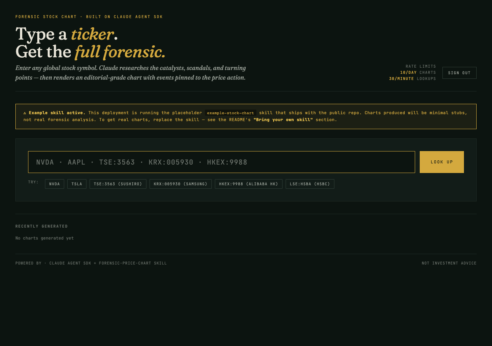
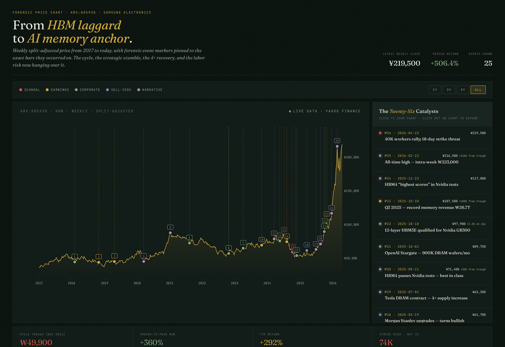

# Forensic Stock Chart

[English](README.md) · **简体中文**

股价曲线每一次有意思的转折，都值得问一句：当时改变了什么？



一个使用 FastAPI、Claude Agent SDK 和可替换 Skill 的网页应用。输入股票代码，查看解析结果，确认后生成可以打开和下载的 HTML 图表。



*已有图表样例来自配合研究 Skill 的生成结果。公开仓库附带的是最简示例 Skill；完整研究能力需要自行提供。*

## 应用提供什么

- 通过 `yfinance` 解析不同市场的股票代码与元数据。
- 股票搜索、结果预览、生成与图表展示界面。
- 共享密码登录、签名 Cookie 与请求频率限制。
- 二十四小时图表缓存。
- Render Blueprint 部署配置。

每次生成的耗时与费用取决于模型、资料和 Skill。请求频率限制控制调用次数，费用预算需要结合提供商计费单独管理。

## 本地运行

```bash
git clone https://github.com/Bill306/forensics.git
cd forensics
python -m venv .venv
source .venv/bin/activate
pip install -r requirements.txt
cp .env.example .env
```

在 `.env` 配置 `ANTHROPIC_API_KEY`、`APP_PASSWORD` 和 `APP_SECRET_KEY`。可使用 `openssl rand -hex 32` 生成签名密钥。

```bash
uvicorn app:app --env-file .env --host 127.0.0.1 --port 8000
```

打开 `http://localhost:8000`。该命令显式读取 `.env` 并仅监听本机；`python app.py` 则读取进程环境并监听全部网络接口。

## 接入自己的 Skill

Skill 需要读取股票元数据和指定输出路径，完成研究后，把自包含 HTML 写入那个路径。最简示例位于 `.claude/skills/example-stock-chart/`。

可以选择适合自己的文件管理方式：

- 放入自己仓库的 `.claude/skills/<name>/`，按需调整 `.gitignore`，设置 `SKILL_NAME`。
- 将 Skill 打包为 `tar.gz`，构建时由 `scripts/fetch_skills.py` 读取 `SKILLS_BUNDLE_URL`；需要授权时提供 `SKILLS_BUNDLE_TOKEN`。
- 仅保存在本机的 `.claude/skills/` 中，并在本地环境设置 `SKILL_NAME`。

签名下载地址本身可能包含访问权限，需要当作凭据保存。构建下载会检查路径；检查下载结果与当前 Skill 提示，确认研究能力实际可用。

SDK 需要 `cwd=BASE_DIR`、`setting_sources=["project"]`，并在 `allowed_tools` 中允许 `Skill`。相关配置保存在 [app.py](app.py)。

## 部署与运行配置

Render 中创建 Blueprint，连接本仓库并读取 [render.yaml](render.yaml)。环境需要模型 API Key 与共享密码；Blueprint 为 `APP_SECRET_KEY` 配置自动生成。

默认 `RATE_LIMIT_GENERATE=10/day`、`RATE_LIMIT_RESOLVE=30/minute`，可通过环境变量修改。长期保存图表需要持久化存储。生成请求可能耗时较长，部署环境需要支持对应的运行时间。

遇到最简输出时检查 `SKILL_NAME` 和 Skill 文件；登录反复失效时检查签名密钥与 Cookie；遇到 `429` 时检查频率限制；重新部署后图表消失时检查持久化目录。

## 使用范围与许可

图表中的事件、时间与归因需要阅读原始来源核验。`yfinance` 是非官方数据适配器，资料可用性与口径需要检查。共享密码用于个人或受控团队场景，扩大使用范围需要相应账号与访问管理。

应用框架、界面、配置和示例 Skill 采用 [MIT License](LICENSE)。自行加入的 Skill 按其自己的许可使用。原项目致谢与完整技术说明保留在英文 README。
